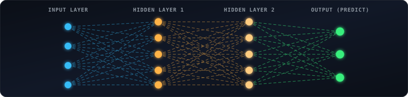
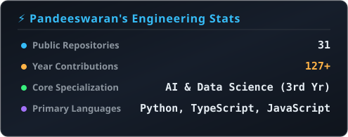
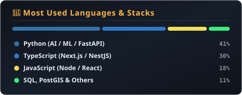

<!-- Profile Header Banner -->

  

<!-- Animated wave header -->

  

<!-- Typing animation -->

  

 

  
  
  

 

<!-- Scrolling tech ticker -->

  

  

## 👨‍💻 About Me

I'm a B.Tech student in Artificial Intelligence and Data Science at **Nadar Saraswathi College of Engineering and Technology (NSCET), Theni**, affiliated with Anna University. I'm building my skills toward a career as an AI Engineer, specializing in Machine Learning, Graph Neural Networks, LLMs/RAG, and Full-Stack Engineering.

- 🔭 **Current Focus:** Deep Learning, Autonomous AI Agents & GNN Architectures
- 🎓 **Academics:** 3rd Year B.Tech AI & Data Science @ NSCET
- 💼 **Open To:** AI/ML Internships, Freelance Development & Collaborative Research
- 💬 **Ask Me About:** Python, FastAPI, PyTorch, Next.js, and Satellite Geospatial Analytics

## 🔭 Featured Projects

<table>
  <tr>
    <td width="50%">
      <b>🛰️ <a href="https://github.com/pandeeswaran-08/GeoSentinel">GeoSentinel</a></b> 
      On-premises AI-powered satellite intelligence backend for semantic image retrieval, multi-temporal change detection, geospatial analysis, and alerting using FastAPI, PyTorch, PostGIS, GDAL, and FAISS.
    </td>
    <td width="50%">
      <b>🏔️ <a href="https://github.com/pandeeswaran-08/LEWAS">LEWAS: Landslide Early Warning System</a></b> 
      Western Ghats & NER multi-agent early warning system integrating rainfall, terrain, Sentinel-1/2 satellite data, and IoT sensor telemetry for risk assessment.
    </td>
  </tr>
  <tr>
    <td width="50%">
      <b>🕸️ Financial Fraud Graph Engine</b> 
      Real-time fraud detection and anomaly classification using GraphSAGE (GNN), FastAPI, and React.
    </td>
    <td width="50%">
      <b>📡 WiFi Presence Detection</b> 
      Final-year research project on device-free human presence sensing and motion tracking using CSI signals.
    </td>
  </tr>
  <tr>
    <td width="50%">
      <b>🎓 <a href="https://github.com/pandeeswaran-08/SIH-">SIH Enrolment Platform</a></b> 
      Evidence-linked AICTE + APAAR student verification pipeline with Next.js, NestJS, OCR, and anomaly detection.
    </td>
    <td width="50%">
      <b>💳 Fee Collection System</b> 
      Departmental full-stack fee management & receipt tracking web app built for NSCET.
    </td>
  </tr>
</table>

## 🧠 Neural Architecture & Deep Learning

  

  

## 🛠️ Tech Stack & Tooling

  
  
  
  
  
  
  
  
  
  

 

## 📟 Contribution Monitor

  <picture>
    <source media="(prefers-color-scheme: dark)" srcset="assets/amber-dark.svg" />
    <source media="(prefers-color-scheme: light)" srcset="assets/amber-light.svg" />
    
  </picture>

 

## 📊 GitHub Analytics

  
  

 

  

 

## 🐍 Contribution Snake

  <picture>
    <source media="(prefers-color-scheme: dark)" srcset="assets/github-snake-dark.svg" />
    <source media="(prefers-color-scheme: light)" srcset="assets/github-snake.svg" />
    
  </picture>

 

## 📫 Connect With Me

  
  
  

 

<!-- Animated footer -->

  

