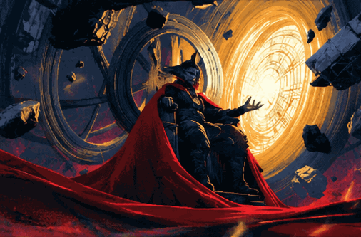

<!-- Magical portal animation (head) -->

  

<!-- Animated wave header -->

  

<!-- Typing animation -->

  

 

  
  
  

 

<!-- Scrolling tech ticker -->

  

  

## 👨‍💻 About Me

I'm a B.Tech student in Artificial Intelligence and Data Science at **Nadar Saraswathi College of Engineering and Technology (NSCET), Theni**, affiliated with Anna University. I'm building my skills toward a career as an AI Engineer, and I enjoy turning ideas into working software.

## 🔭 What I'm Working On

<table>
  <tr>
    <td><b>🕸️ Financial Fraud Graph Engine</b> Fraud detection with GraphSAGE, FastAPI and React</td>
    <td><b>📡 WiFi Presence Detection</b> Human presence and motion tracking (final year project)</td>
  </tr>
  <tr>
    <td><b>🎓 SIH26263 Enrolment Platform</b> AICTE + APAAR verification with Next.js and NestJS</td>
    <td><b>💳 Fee Collection System</b> Full-stack web app for NSCET</td>
  </tr>
  <tr>
    <td colspan="2" align="center"><b>🛍️ BuyCircle</b> Social commerce mobile app concept: "Shop Smarter Through Friends"</td>
  </tr>
</table>

## 🧠 Always Learning

  

  

## 🌱 Currently Focused On

- Growing toward an AI Engineer career path
- Exploring freelancing and content creation alongside my studies
- Contributing to departmental work at NSCET

## 🛠️ Tech Stack

  
  
  
  
  
  

## 📫 Connect With Me

  
  
  

## 📊 GitHub Stats

  
  

  

## 📟 Contribution Monitor

  <picture>
    <source media="(prefers-color-scheme: dark)" srcset="assets/amber-dark.svg" />
    
  </picture>

## 🐍 Contribution Snake

  <picture>
    <source media="(prefers-color-scheme: dark)" srcset="https://raw.githubusercontent.com/pandeesp448-lgtm/pandeesp448-lgtm/output/github-snake-dark.svg" />
    
  </picture>

 

<!-- Animated footer -->

  

